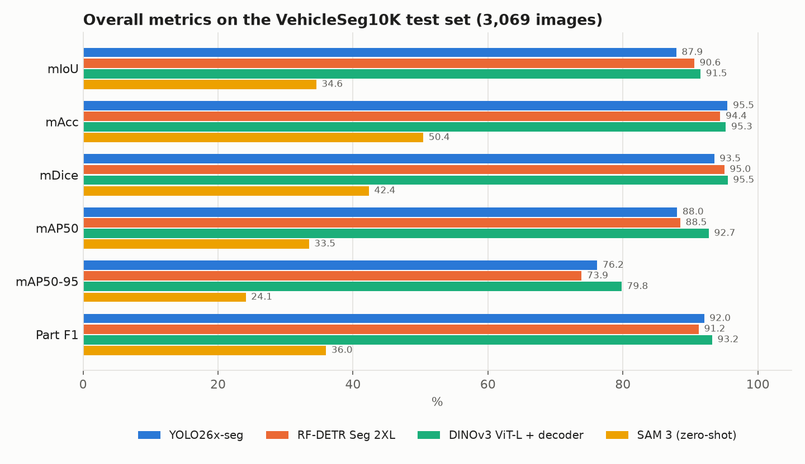
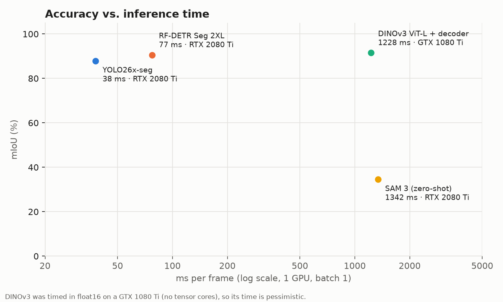
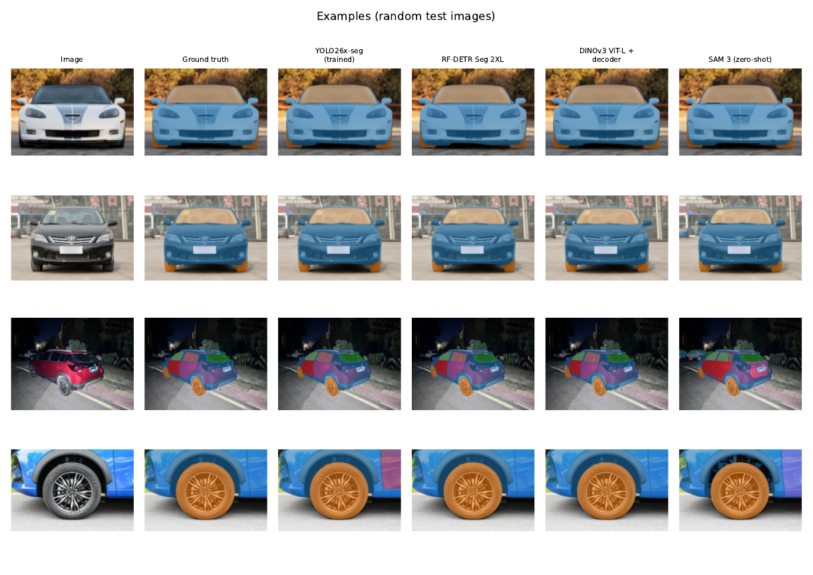
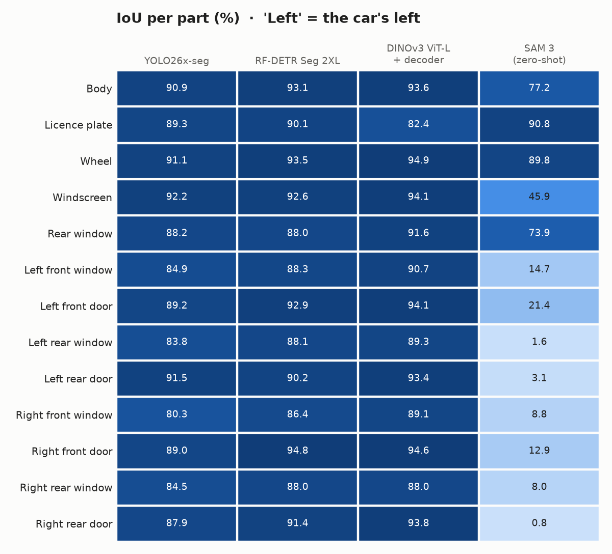
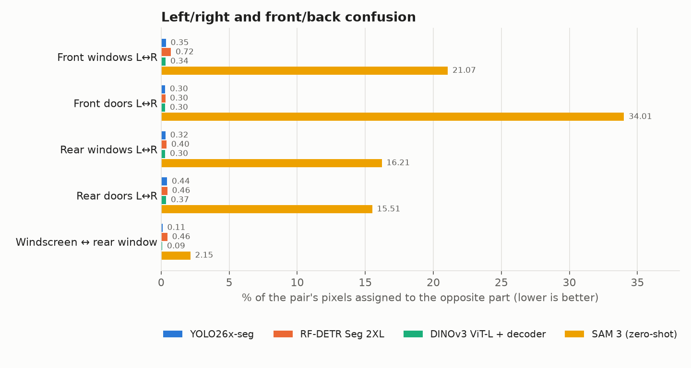
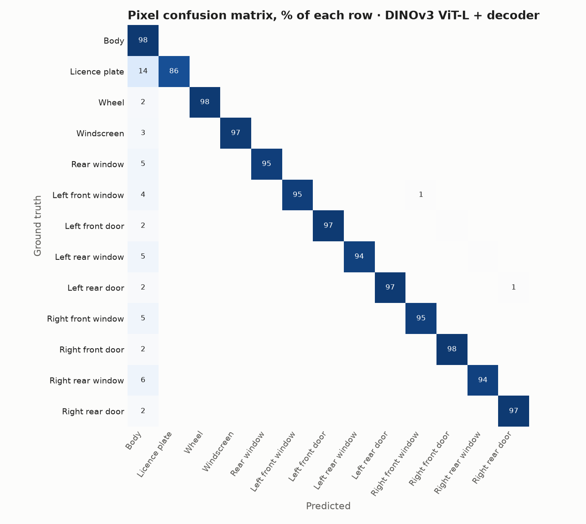

# Segmentación de piezas de coche en VehicleSeg10K

[English](README.md) · Pesos entrenados: [Hugging Face](https://huggingface.co/MrBr1ghts1d3/VehiclePartsSegmentatorFTModels)

Comparación de cuatro modelos de segmentación sobre **VehicleSeg10K** (13 piezas de coche). Todos se entrenan, se ejecutan y se puntúan con los mismos datos, el mismo código de evaluación y las mismas métricas.

| Modelo | Enfoque |
|---|---|
| **YOLO26x-seg** (Ultralytics) | Segmentación de instancias, afinado desde pesos COCO |
| **RF-DETR Seg 2XL** (Roboflow) | Segmentación de instancias, afinado desde pesos COCO |
| **DINOv3 ViT-L/16 + decodificador** (Meta) | Backbone congelado con un decodificador por píxel tipo FPN entrenado encima (segmentación semántica) |
| **SAM 3** (Meta) | Guiado por texto, una consulta por pieza, en zero-shot |

El informe completo está en [`resultados/informe/informe_segmentacion_piezas.pdf`](resultados/informe/informe_segmentacion_piezas.pdf) ([versión en inglés](resultados/informe/car_part_segmentation_report.pdf)).

## Resultados

Test: el split oficial `valid`, con 3.069 imágenes. Nunca se usa para elegir checkpoint: siempre se evalúa la última época.

| Modelo | mIoU | mAcc | mDice | mAP50 | mAP50-95 | F1 piezas | ms/fotograma | GPU (inferencia) | Parámetros | VRAM pico |
|---|---|---|---|---|---|---|---|---|---|---|
| **DINOv3 ViT-L + decodificador** | **91,50** | 95,25 | **95,53** | **92,72** | **79,80** | **93,22** | 1228 ¹ | GTX 1080 Ti | 0,3 B congelados + 5,4 M | – |
| RF-DETR Seg 2XL | 90,57 | 94,43 | 95,03 | 88,50 | 73,89 | 91,24 | 77 | RTX 2080 Ti | 38,4 M | 7,4 GB |
| YOLO26x-seg | 87,91 | **95,51** | 93,53 | 88,03 | 76,19 | 92,04 | **38** | RTX 2080 Ti | 70,5 M | 2,6 GB |
| SAM 3 (zero-shot) | 34,55 | 50,41 | 42,35 | 33,47 | 24,11 | 36,00 | 1342 ² | RTX 2080 Ti | 848 M | – |

¹ Ejecutado en float16 en una GTX 1080 Ti (Pascal, sin núcleos tensor), donde float16 va muy lento. Ese tiempo no representa la velocidad del modelo en una GPU moderna. `05_dinov3/predecir.py` ya usa float32 en GPUs Pascal.
² 13 consultas de texto por foto, una por pieza.

- **Qué incluye el tiempo:** una GPU, lote 1, desde la imagen decodificada en memoria hasta las máscaras a resolución completa. No incluye la lectura del disco, y la primera imagen (calentamiento) se descarta.
- **Qué es "VRAM pico":** la memoria de GPU máxima que reservó PyTorch durante la inferencia.

SAM 3 en zero-shot encuentra bien la carrocería, las ruedas y la matrícula, pero no distingue las puertas y ventanillas de cada lado (IoU por debajo del 22 % en las ocho). Los números por pieza están en [`resultados/informe/por_clase.csv`](resultados/informe/por_clase.csv).





### Imágenes de test

Imágenes de test elegidas al azar: la entrada, la máscara real y la predicción de cada modelo. Cada color es una pieza.



### Por pieza



### Confusión izquierda/derecha

Distinguir la izquierda del coche de su derecha es lo más difícil de este dataset. Los modelos entrenados confunden menos del 1 % de los píxeles de cada par; SAM 3 en zero-shot llega al 34 %.





<details>
<summary><b>Todas las tablas por pieza</b> (IoU, exactitud por píxel, F1 y recall de detección, confusión izquierda/derecha)</summary>

### IoU por pieza (%)

| Pieza | YOLO26x-seg | RF-DETR Seg 2XL | DINOv3 ViT-L + decodificador | SAM 3 (zero-shot) |
|---|---|---|---|---|
| Carrocería | 90.9 | 93.1 | **93.6** | 77.2 |
| Matrícula | 89.3 | 90.1 | 82.4 | **90.8** |
| Rueda | 91.1 | 93.5 | **94.9** | 89.8 |
| Parabrisas | 92.2 | 92.6 | **94.1** | 45.9 |
| Luneta | 88.2 | 88.0 | **91.6** | 73.9 |
| Ventanilla del. izq. | 84.9 | 88.3 | **90.7** | 14.7 |
| Puerta del. izq. | 89.2 | 92.9 | **94.1** | 21.4 |
| Ventanilla tras. izq. | 83.8 | 88.1 | **89.3** | 1.6 |
| Puerta tras. izq. | 91.5 | 90.2 | **93.4** | 3.1 |
| Ventanilla del. der. | 80.3 | 86.4 | **89.1** | 8.8 |
| Puerta del. der. | 89.0 | **94.8** | 94.6 | 12.9 |
| Ventanilla tras. der. | 84.5 | **88.0** | 88.0 | 8.0 |
| Puerta tras. der. | 87.9 | 91.4 | **93.8** | 0.8 |
| **Media** | 87.9 | 90.6 | 91.5 | 34.6 |

### Exactitud por píxel por pieza (%)

| Pieza | YOLO26x-seg | RF-DETR Seg 2XL | DINOv3 ViT-L + decodificador | SAM 3 (zero-shot) |
|---|---|---|---|---|
| Carrocería | 94.3 | **96.7** | 96.7 | 82.8 |
| Matrícula | 94.9 | 92.9 | 86.3 | **97.5** |
| Rueda | **97.7** | 95.8 | 97.0 | 97.7 |
| Parabrisas | **97.9** | 96.6 | 96.8 | 94.5 |
| Luneta | 94.5 | 92.3 | **95.1** | 91.4 |
| Ventanilla del. izq. | **97.1** | 94.0 | 94.9 | 52.9 |
| Puerta del. izq. | 96.5 | 96.5 | **97.3** | 64.1 |
| Ventanilla tras. izq. | 92.5 | 92.2 | **93.7** | 1.7 |
| Puerta tras. izq. | 97.3 | 92.1 | **97.3** | 6.5 |
| Ventanilla del. der. | **95.7** | 94.7 | 94.8 | 21.5 |
| Puerta del. der. | 96.3 | 97.1 | **97.7** | 28.7 |
| Ventanilla tras. der. | **94.3** | 93.0 | 93.5 | 14.3 |
| Puerta tras. der. | 92.6 | 93.8 | **97.3** | 1.8 |
| **Media** | 95.5 | 94.4 | 95.3 | 50.4 |

### F1 de detección por pieza (%)

| Pieza | YOLO26x-seg | RF-DETR Seg 2XL | DINOv3 ViT-L + decodificador | SAM 3 (zero-shot) |
|---|---|---|---|---|
| Carrocería | 96.4 | 77.2 | **98.8** | 76.6 |
| Matrícula | 90.9 | **93.1** | 91.6 | 91.8 |
| Rueda | 91.1 | **93.9** | 93.7 | 90.9 |
| Parabrisas | 93.4 | 94.0 | **94.5** | 61.2 |
| Luneta | 88.6 | 90.9 | **91.7** | 55.0 |
| Ventanilla del. izq. | 91.4 | 90.1 | **92.9** | 19.8 |
| Puerta del. izq. | **93.6** | 93.4 | 93.4 | 18.5 |
| Ventanilla tras. izq. | 92.2 | 93.3 | **93.8** | 21.9 |
| Puerta tras. izq. | 92.3 | **92.5** | 91.7 | 0.5 |
| Ventanilla del. der. | 91.4 | 90.5 | **93.6** | 3.3 |
| Puerta del. der. | 92.6 | **93.1** | 92.6 | 5.9 |
| Ventanilla tras. der. | 91.3 | 93.1 | **93.6** | 16.7 |
| Puerta tras. der. | **91.3** | 91.1 | 90.1 | 6.0 |
| **Media** | 92.0 | 91.2 | 93.2 | 36.0 |

### Recall de detección por pieza (%)

| Pieza | YOLO26x-seg | RF-DETR Seg 2XL | DINOv3 ViT-L + decodificador | SAM 3 (zero-shot) |
|---|---|---|---|---|
| Carrocería | 93.9 | 77.1 | **99.1** | 76.7 |
| Matrícula | 86.3 | 91.3 | 91.9 | **96.3** |
| Rueda | 89.5 | 94.2 | **94.9** | 93.7 |
| Parabrisas | 91.9 | **97.1** | 95.0 | 93.0 |
| Luneta | 84.5 | 90.7 | **95.2** | 90.3 |
| Ventanilla del. izq. | 89.8 | 90.9 | **93.7** | 28.7 |
| Puerta del. izq. | 91.9 | 93.1 | **93.2** | 24.1 |
| Ventanilla tras. izq. | 91.1 | 92.2 | **94.8** | 32.2 |
| Puerta tras. izq. | 90.3 | 91.9 | **92.8** | 0.8 |
| Ventanilla del. der. | 90.8 | 92.1 | **94.7** | 5.5 |
| Puerta del. der. | 91.3 | 92.0 | **93.6** | 9.4 |
| Ventanilla tras. der. | 90.9 | 93.5 | **95.8** | 30.0 |
| Puerta tras. der. | 89.7 | 91.0 | **91.8** | 9.7 |
| **Media** | 90.2 | 91.3 | 94.4 | 45.4 |

### Confusión izquierda/derecha y delante/detrás (% de píxeles, más bajo es mejor)

| Par | YOLO26x-seg | RF-DETR Seg 2XL | DINOv3 ViT-L + decodificador | SAM 3 (zero-shot) |
|---|---|---|---|---|
| Ventanillas delanteras I↔D | 0.35 | 0.72 | **0.34** | 21.07 |
| Puertas delanteras I↔D | **0.30** | 0.30 | 0.30 | 34.01 |
| Ventanillas traseras I↔D | 0.32 | 0.40 | **0.30** | 16.21 |
| Puertas traseras I↔D | 0.44 | 0.46 | **0.37** | 15.51 |
| Parabrisas ↔ luneta | 0.11 | 0.46 | **0.09** | 2.15 |
</details>

Las gráficas tienen los textos en inglés.

### Métricas
- **Por píxel (mIoU, mAcc, mDice):**
  - Se construye un mapa de etiquetas por imagen: primero la carrocería y encima las piezas, la más confiada al final.
  - Se compara con la máscara PNG oficial.
  - Cuentan 13 clases, sin el fondo, y los píxeles se acumulan sobre todo el test.
- **Detección de piezas (precisión, recall, F1):** una pieza cuenta como acertada si la unión de sus máscaras predichas tiene IoU ≥ 0,5 con la real. El umbral de confianza es 0,25.
- **mAP50, mAP75 y mAP50-95:** estilo COCO con pycocotools, con una máscara por clase e imagen.
- **Confusión izquierda/derecha y delante/detrás:** el % de píxeles de cada par de piezas que el modelo asigna a la pieza contraria.

## Dataset

[VehicleSeg10K](https://github.com/Event-AHU/SAV) se publicó con el artículo *Segment Any Vehicle* (Event-AHU).
- 8.596 imágenes de entrenamiento y 3.069 de `valid`.
- 13 clases: carrocería, matrícula, rueda, parabrisas, luneta y las cuatro puertas y cuatro ventanillas con su lado.
- **"Left" es la izquierda del coche** (punto de vista del conductor), no la de la foto. Por eso **ningún modelo se entrena con volteo horizontal**: un volteo convierte una puerta izquierda en una derecha.

El dataset no se incluye aquí. `00_dataset/descargar.sh` lo descarga del enlace de los autores.

## Estructura

```
00_dataset/      descarga y conversión a formatos COCO / YOLO / SAM 3
01_yolo/         instalación, entrenamiento y predicción (YOLO26-seg)
03_sam3/         instalación, parches para GPUs anteriores a Ampere, afinado, predicción (también repartida entre GPUs)
04_evaluacion/   evaluación común, métricas e informe PDF (español + inglés)
05_dinov3/       instalación, entrenamiento del decodificador sobre DINOv3 congelado, predicción
06_rfdetr/       instalación, conversión de datos, entrenamiento y predicción (RF-DETR Seg)
resultados/      resultados de la ejecución de arriba (PDFs del informe, CSVs, JSON de métricas)
```

Cada modelo guarda sus predicciones en un formato común en `resultados/predicciones/<nombre>.json`. Junto a ellas escribe un `<nombre>.meta.json` con el tiempo, la GPU, los parámetros y la VRAM pico. Después `04_evaluacion/evaluar.py` los puntúa a todos igual.

## Cómo reproducirlo

Cada modelo tiene su propio entorno conda, que crea su `instalar.sh`. Todo se ejecuta desde la raíz del repositorio.

```bash
# 0. Datos
bash 00_dataset/descargar.sh
conda run -n yolo python 00_dataset/preparar_dataset.py      # después de 01_yolo/instalar.sh

# 1. YOLO26x-seg (100 épocas, 768 px, lote 12, 4 GPUs)
bash 01_yolo/instalar.sh
DEVICE=0,1,2,3 IMGSZ=768 BATCH=12 bash 01_yolo/entrenar.sh x
conda run -n yolo python 01_yolo/predecir.py --pesos resultados/yolo/x/weights/last.pt --nombre yolo_x --imgsz 768

# 2. RF-DETR Seg 2XL (50 épocas, lote efectivo 16, 4 GPUs)
bash 06_rfdetr/instalar.sh
DEVICE=0,1,2,3 bash 06_rfdetr/entrenar.sh
conda run -n rfdetr python 06_rfdetr/predecir.py --pesos resultados/rfdetr/2xl/last_ema.pth --nombre rfdetr_2xl

# 3. DINOv3 ViT-L/16 + decodificador (40 épocas, 768 px, lote 32, 4 GPUs)
#    Antes, pide acceso: https://huggingface.co/facebook/dinov3-vitl16-pretrain-lvd1689m
bash 05_dinov3/instalar.sh
DEVICE=0,1,2,3 bash 05_dinov3/entrenar.sh
conda run -n dinov3 python 05_dinov3/predecir.py --pesos resultados/dinov3/vitl16/last.pt --nombre dinov3_vitl16

# 4. SAM 3 zero-shot (antes, pide acceso: https://huggingface.co/facebook/sam3)
bash 03_sam3/instalar.sh
conda run -n sam3 python 03_sam3/preparar_prompts.py
bash 03_sam3/predecir_4gpus.sh                      # un proceso por GPU; GPUS=0 para una sola

# 5. Evaluación e informe
conda run -n yolo python 04_evaluacion/evaluar.py
```

El informe se guarda en `resultados/informe/`. Para rehacer solo los PDFs a partir de las métricas guardadas, ejecuta `evaluar.py --solo-informe`. Las gráficas y tablas del README salen de `04_evaluacion/graficas_readme.py`.

### Hardware usado
- **Entrenamiento:**
  - YOLO y RF-DETR: 4× NVIDIA RTX 2080 Ti (11 GB).
  - DINOv3: 4× NVIDIA GTX 1080 Ti (11 GB).
- **Inferencia:** en una sola GPU del mismo tipo.

### Notas sobre SAM 3 en GPUs antiguas (RTX 2080 Ti, Turing)
- **Sin bfloat16:** estas GPUs no tienen bfloat16, así que se usa float16.
- **Errores de cuBLAS:** con PyTorch 2.10 + CUDA 12.8, toda multiplicación de matrices en float16 por cuBLAS falla con `CUBLAS_STATUS_INVALID_VALUE`, mientras que por cuBLASLt funciona (`03_sam3/probar_fp16.py`). Los scripts eligen cuBLASLt.
- **Código parcheado:** `03_sam3/parchear_sam3.py` parchea dos puntos del código oficial que fuerzan bfloat16.
- **Memoria:** `03_sam3/predecir.py` reescala solo las mejores detecciones y por bloques, para no quedarse sin memoria con 11 GB.
- **Afinado:** los scripts están incluidos (`03_sam3/entrenar.sh`, con el backbone congelado), pero aquí no se evalúa ningún SAM 3 afinado.

## Licencias

- **Código de este repositorio:** MIT ([LICENSE](LICENSE)).
- **Dependencias:** cada una mantiene su licencia. Ultralytics YOLO es AGPL-3.0, RF-DETR es Apache-2.0, y DINOv3 y SAM 3 tienen licencias propias de Meta. Para descargar los pesos de DINOv3 y SAM 3 hay que aceptar sus licencias en Hugging Face.
- **VehicleSeg10K:** pertenece a sus autores y no se redistribuye aquí.

## Cita

Si usas el dataset, cita su artículo:

```bibtex
@misc{wang2025SAV,
  title         = {Segment Any Vehicle: Semantic and Visual Context Driven SAM and A Benchmark},
  author        = {Xiao Wang and Ziwen Wang and Wentao Wu and Anjie Wang and Jiashu Wu and Yantao Pan and Chenglong Li},
  year          = {2025},
  eprint        = {2508.04260},
  archivePrefix = {arXiv},
  primaryClass  = {cs.CV},
  url           = {https://arxiv.org/abs/2508.04260}
}
```
