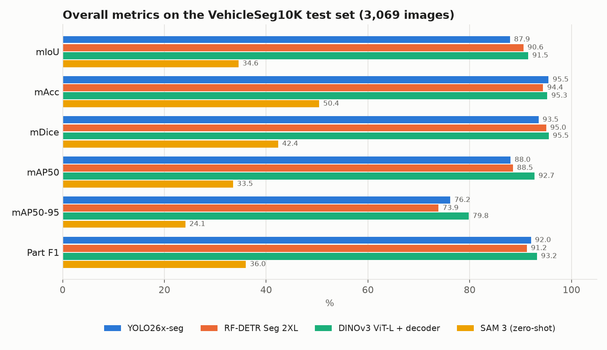
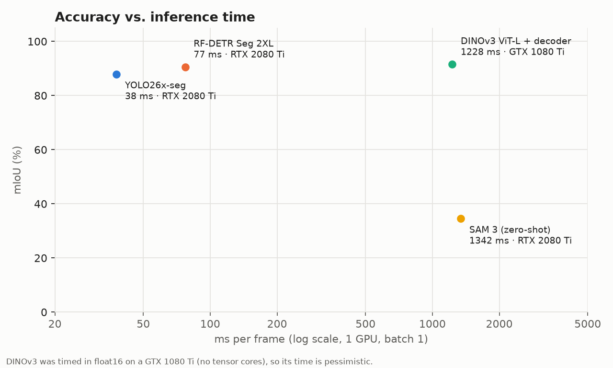
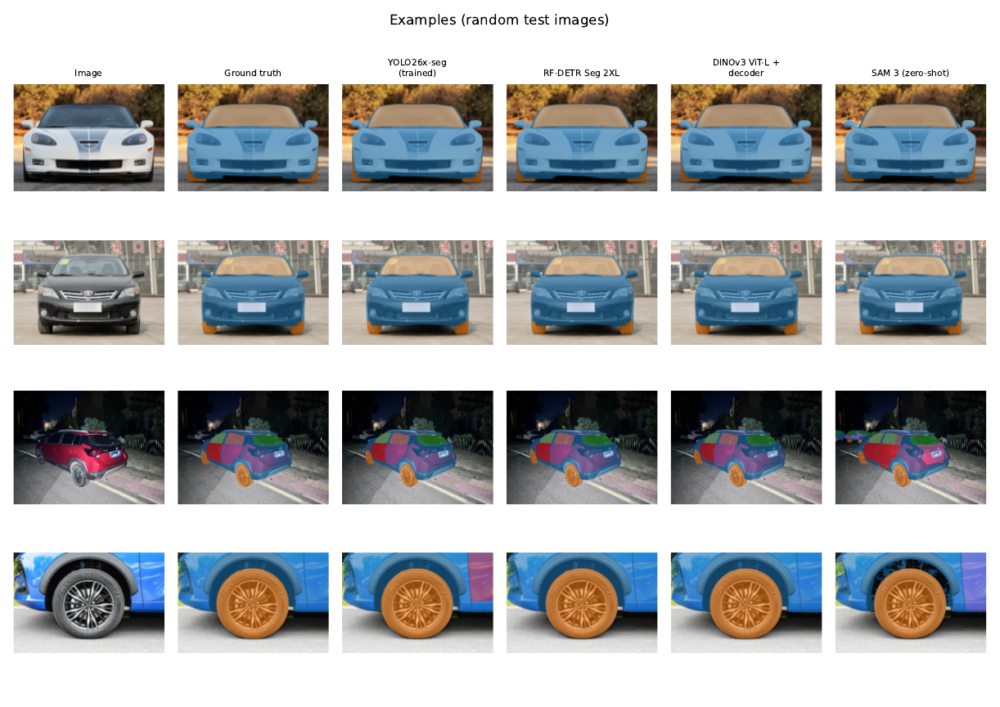
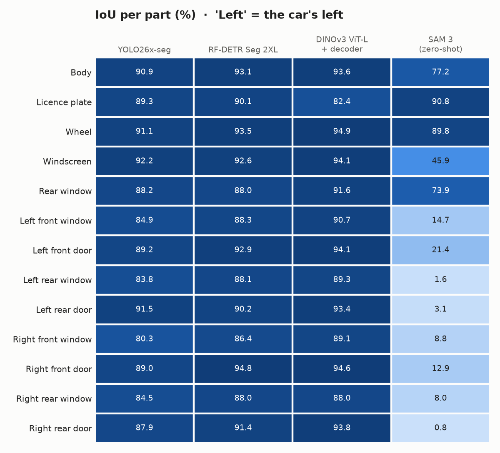
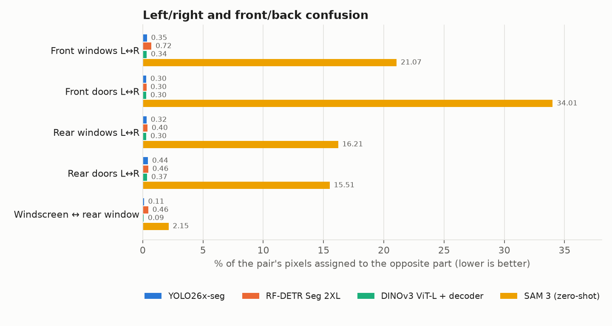
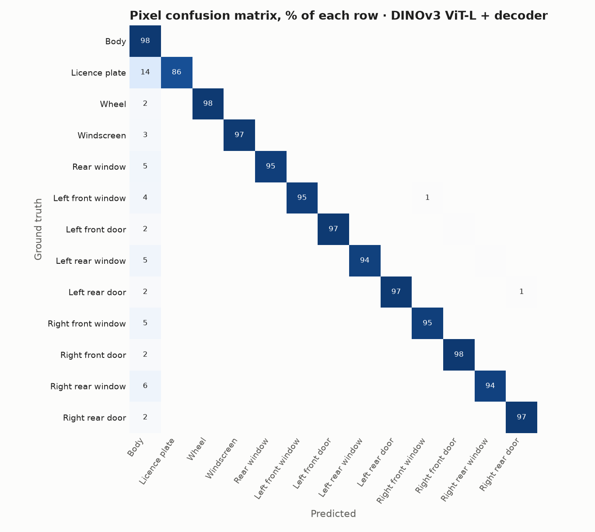

# Car-part segmentation on VehicleSeg10K

[Español](README.es.md) · Trained weights: [Hugging Face](https://huggingface.co/MrBr1ghts1d3/VehiclePartsSegmentatorFTModels)

Comparison of four segmentation models on **VehicleSeg10K** (13 car parts), all trained, run and scored with the same data, the same evaluation code and the same metrics.

| Model | Approach |
|---|---|
| **YOLO26x-seg** (Ultralytics) | Instance segmentation, fine-tuned from COCO weights |
| **RF-DETR Seg 2XL** (Roboflow) | Instance segmentation, fine-tuned from COCO weights |
| **DINOv3 ViT-L/16 + decoder** (Meta) | Frozen backbone with a trained FPN-style pixel decoder (semantic segmentation) |
| **SAM 3** (Meta) | Text-prompted, one prompt per part, used zero-shot |

The full report is in [`resultados/informe/car_part_segmentation_report.pdf`](resultados/informe/car_part_segmentation_report.pdf) ([Spanish version](resultados/informe/informe_segmentacion_piezas.pdf)).

## Results

Test set: the official `valid` split, 3,069 images. It is never used to choose a checkpoint: the last epoch is always evaluated.

| Model | mIoU | mAcc | mDice | mAP50 | mAP50-95 | Part F1 | ms/frame | GPU (inference) | Params | Peak VRAM |
|---|---|---|---|---|---|---|---|---|---|---|
| **DINOv3 ViT-L + decoder** | **91.50** | 95.25 | **95.53** | **92.72** | **79.80** | **93.22** | 1228 ¹ | GTX 1080 Ti | 0.3 B frozen + 5.4 M | – |
| RF-DETR Seg 2XL | 90.57 | 94.43 | 95.03 | 88.50 | 73.89 | 91.24 | 77 | RTX 2080 Ti | 38.4 M | 7.4 GB |
| YOLO26x-seg | 87.91 | **95.51** | 93.53 | 88.03 | 76.19 | 92.04 | **38** | RTX 2080 Ti | 70.5 M | 2.6 GB |
| SAM 3 (zero-shot) | 34.55 | 50.41 | 42.35 | 33.47 | 24.11 | 36.00 | 1342 ² | RTX 2080 Ti | 848 M | – |

¹ Run in float16 on a GTX 1080 Ti (Pascal, no tensor cores), where float16 is very slow. That time does not represent the model's speed on a modern GPU. `05_dinov3/predecir.py` now uses float32 on Pascal GPUs.
² 13 text prompts per photo, one per part.

- **What the timing covers:** one GPU, batch size 1, from the decoded image in memory to the final full-resolution masks. Reading from disk is not included, and the first image (warm-up) is discarded.
- **What "Peak VRAM" is:** the maximum GPU memory reserved by PyTorch during inference.

SAM 3 zero-shot finds the body, wheels and licence plate well, but it cannot tell the doors and side windows of each side apart (IoU below 22 % on all eight). Per-part numbers are in [`resultados/informe/por_clase.csv`](resultados/informe/por_clase.csv).





### Test images

Random test images: the input, the ground truth, and the prediction of each model. Each colour is one part.



### Per part



### Left/right confusion

Telling the car's left from its right is the hardest part of this dataset. The trained models confuse less than 1 % of the pixels of each pair; SAM 3 zero-shot confuses up to 34 %.





<details>
<summary><b>All per-part tables</b> (IoU, pixel accuracy, detection F1 and recall, left/right confusion)</summary>

### IoU per part (%)

| Part | YOLO26x-seg | RF-DETR Seg 2XL | DINOv3 ViT-L + decoder | SAM 3 (zero-shot) |
|---|---|---|---|---|
| Body | 90.9 | 93.1 | **93.6** | 77.2 |
| Licence plate | 89.3 | 90.1 | 82.4 | **90.8** |
| Wheel | 91.1 | 93.5 | **94.9** | 89.8 |
| Windscreen | 92.2 | 92.6 | **94.1** | 45.9 |
| Rear window | 88.2 | 88.0 | **91.6** | 73.9 |
| Left front window | 84.9 | 88.3 | **90.7** | 14.7 |
| Left front door | 89.2 | 92.9 | **94.1** | 21.4 |
| Left rear window | 83.8 | 88.1 | **89.3** | 1.6 |
| Left rear door | 91.5 | 90.2 | **93.4** | 3.1 |
| Right front window | 80.3 | 86.4 | **89.1** | 8.8 |
| Right front door | 89.0 | **94.8** | 94.6 | 12.9 |
| Right rear window | 84.5 | **88.0** | 88.0 | 8.0 |
| Right rear door | 87.9 | 91.4 | **93.8** | 0.8 |
| **Mean** | 87.9 | 90.6 | 91.5 | 34.6 |

### Pixel accuracy per part (%)

| Part | YOLO26x-seg | RF-DETR Seg 2XL | DINOv3 ViT-L + decoder | SAM 3 (zero-shot) |
|---|---|---|---|---|
| Body | 94.3 | **96.7** | 96.7 | 82.8 |
| Licence plate | 94.9 | 92.9 | 86.3 | **97.5** |
| Wheel | **97.7** | 95.8 | 97.0 | 97.7 |
| Windscreen | **97.9** | 96.6 | 96.8 | 94.5 |
| Rear window | 94.5 | 92.3 | **95.1** | 91.4 |
| Left front window | **97.1** | 94.0 | 94.9 | 52.9 |
| Left front door | 96.5 | 96.5 | **97.3** | 64.1 |
| Left rear window | 92.5 | 92.2 | **93.7** | 1.7 |
| Left rear door | 97.3 | 92.1 | **97.3** | 6.5 |
| Right front window | **95.7** | 94.7 | 94.8 | 21.5 |
| Right front door | 96.3 | 97.1 | **97.7** | 28.7 |
| Right rear window | **94.3** | 93.0 | 93.5 | 14.3 |
| Right rear door | 92.6 | 93.8 | **97.3** | 1.8 |
| **Mean** | 95.5 | 94.4 | 95.3 | 50.4 |

### Detection F1 per part (%)

| Part | YOLO26x-seg | RF-DETR Seg 2XL | DINOv3 ViT-L + decoder | SAM 3 (zero-shot) |
|---|---|---|---|---|
| Body | 96.4 | 77.2 | **98.8** | 76.6 |
| Licence plate | 90.9 | **93.1** | 91.6 | 91.8 |
| Wheel | 91.1 | **93.9** | 93.7 | 90.9 |
| Windscreen | 93.4 | 94.0 | **94.5** | 61.2 |
| Rear window | 88.6 | 90.9 | **91.7** | 55.0 |
| Left front window | 91.4 | 90.1 | **92.9** | 19.8 |
| Left front door | **93.6** | 93.4 | 93.4 | 18.5 |
| Left rear window | 92.2 | 93.3 | **93.8** | 21.9 |
| Left rear door | 92.3 | **92.5** | 91.7 | 0.5 |
| Right front window | 91.4 | 90.5 | **93.6** | 3.3 |
| Right front door | 92.6 | **93.1** | 92.6 | 5.9 |
| Right rear window | 91.3 | 93.1 | **93.6** | 16.7 |
| Right rear door | **91.3** | 91.1 | 90.1 | 6.0 |
| **Mean** | 92.0 | 91.2 | 93.2 | 36.0 |

### Detection recall per part (%)

| Part | YOLO26x-seg | RF-DETR Seg 2XL | DINOv3 ViT-L + decoder | SAM 3 (zero-shot) |
|---|---|---|---|---|
| Body | 93.9 | 77.1 | **99.1** | 76.7 |
| Licence plate | 86.3 | 91.3 | 91.9 | **96.3** |
| Wheel | 89.5 | 94.2 | **94.9** | 93.7 |
| Windscreen | 91.9 | **97.1** | 95.0 | 93.0 |
| Rear window | 84.5 | 90.7 | **95.2** | 90.3 |
| Left front window | 89.8 | 90.9 | **93.7** | 28.7 |
| Left front door | 91.9 | 93.1 | **93.2** | 24.1 |
| Left rear window | 91.1 | 92.2 | **94.8** | 32.2 |
| Left rear door | 90.3 | 91.9 | **92.8** | 0.8 |
| Right front window | 90.8 | 92.1 | **94.7** | 5.5 |
| Right front door | 91.3 | 92.0 | **93.6** | 9.4 |
| Right rear window | 90.9 | 93.5 | **95.8** | 30.0 |
| Right rear door | 89.7 | 91.0 | **91.8** | 9.7 |
| **Mean** | 90.2 | 91.3 | 94.4 | 45.4 |

### Left/right and front/back confusion (% of pixels, lower is better)

| Pair | YOLO26x-seg | RF-DETR Seg 2XL | DINOv3 ViT-L + decoder | SAM 3 (zero-shot) |
|---|---|---|---|---|
| Front windows L↔R | 0.35 | 0.72 | **0.34** | 21.07 |
| Front doors L↔R | **0.30** | 0.30 | 0.30 | 34.01 |
| Rear windows L↔R | 0.32 | 0.40 | **0.30** | 16.21 |
| Rear doors L↔R | 0.44 | 0.46 | **0.37** | 15.51 |
| Windscreen ↔ rear window | 0.11 | 0.46 | **0.09** | 2.15 |
</details>

### Metrics
- **Pixel metrics (mIoU, mAcc, mDice):**
  - A label map is built per image: the body goes first, then the parts on top, most confident last.
  - It is compared with the official PNG mask.
  - The scores cover 13 classes, without background, and pixels are accumulated over the whole test set.
- **Part detection (precision, recall, F1):** a part counts as found if the union of its predicted masks has IoU ≥ 0.5 with the ground truth. The confidence threshold is 0.25.
- **mAP50, mAP75 and mAP50-95:** COCO style with pycocotools, using one mask per class and image.
- **Left/right and front/back confusion:** the share of pixels of each pair of parts that the model assigns to the opposite part.

## Dataset

[VehicleSeg10K](https://github.com/Event-AHU/SAV) was released with the paper *Segment Any Vehicle* (Event-AHU).
- 8,596 training images and 3,069 `valid` images.
- 13 classes: body, licence plate, wheel, windscreen, rear window, and the four doors and four side windows with their side.
- **"Left" means the car's left** (driver's point of view), not the left of the photo. For this reason **no model is trained with horizontal flips**: a flip turns a left door into a right one.

The dataset is not included here. `00_dataset/descargar.sh` downloads it from the authors' link.

## Repository layout

```
00_dataset/      download + conversion to COCO / YOLO / SAM 3 formats
01_yolo/         install, train, predict (YOLO26-seg)
03_sam3/         install, patches for pre-Ampere GPUs, fine-tuning, prediction (also split across GPUs)
04_evaluacion/   common evaluation, metrics and the PDF report (Spanish + English)
05_dinov3/       install, train decoder on frozen DINOv3, predict
06_rfdetr/       install, data conversion, train, predict (RF-DETR Seg)
resultados/      results of the run above (report PDFs, CSVs, metrics JSON)
```

Folder and script names, and code comments, are in Spanish.

Every model writes its predictions in one common format to `resultados/predicciones/<name>.json`, plus a `<name>.meta.json` with timing, GPU, parameters and peak VRAM. `04_evaluacion/evaluar.py` then scores all of them the same way.

## How to reproduce

Each model has its own conda environment, created by its `instalar.sh`. Run everything from the repository root.

```bash
# 0. Data
bash 00_dataset/descargar.sh
conda run -n yolo python 00_dataset/preparar_dataset.py      # after 01_yolo/instalar.sh

# 1. YOLO26x-seg (100 epochs, 768 px, batch 12, 4 GPUs)
bash 01_yolo/instalar.sh
DEVICE=0,1,2,3 IMGSZ=768 BATCH=12 bash 01_yolo/entrenar.sh x
conda run -n yolo python 01_yolo/predecir.py --pesos resultados/yolo/x/weights/last.pt --nombre yolo_x --imgsz 768

# 2. RF-DETR Seg 2XL (50 epochs, effective batch 16, 4 GPUs)
bash 06_rfdetr/instalar.sh
DEVICE=0,1,2,3 bash 06_rfdetr/entrenar.sh
conda run -n rfdetr python 06_rfdetr/predecir.py --pesos resultados/rfdetr/2xl/last_ema.pth --nombre rfdetr_2xl

# 3. DINOv3 ViT-L/16 + decoder (40 epochs, 768 px, batch 32, 4 GPUs)
#    Request access first: https://huggingface.co/facebook/dinov3-vitl16-pretrain-lvd1689m
bash 05_dinov3/instalar.sh
DEVICE=0,1,2,3 bash 05_dinov3/entrenar.sh
conda run -n dinov3 python 05_dinov3/predecir.py --pesos resultados/dinov3/vitl16/last.pt --nombre dinov3_vitl16

# 4. SAM 3 zero-shot (request access first: https://huggingface.co/facebook/sam3)
bash 03_sam3/instalar.sh
conda run -n sam3 python 03_sam3/preparar_prompts.py
bash 03_sam3/predecir_4gpus.sh                      # one process per GPU; GPUS=0 for a single GPU

# 5. Evaluation and report
conda run -n yolo python 04_evaluacion/evaluar.py
```

The report goes to `resultados/informe/`. To rebuild only the PDFs from the saved metrics, run `evaluar.py --solo-informe`. The README charts and tables come from `04_evaluacion/graficas_readme.py`.

### Hardware used
- **Training:**
  - YOLO and RF-DETR: 4× NVIDIA RTX 2080 Ti (11 GB).
  - DINOv3: 4× NVIDIA GTX 1080 Ti (11 GB).
- **Inference:** on a single GPU of the same type.

### Notes on SAM 3 with older GPUs (RTX 2080 Ti, Turing)
- **No bfloat16:** these GPUs have no bfloat16, so float16 is used.
- **cuBLAS errors:** with PyTorch 2.10 + CUDA 12.8, every float16 GEMM through cuBLAS fails with `CUBLAS_STATUS_INVALID_VALUE`, while cuBLASLt works (`03_sam3/probar_fp16.py`). The scripts select cuBLASLt.
- **Patched code:** `03_sam3/parchear_sam3.py` patches two spots in the official code that force bfloat16.
- **Memory:** `03_sam3/predecir.py` upsamples only the top detections, in blocks, to avoid running out of memory on 11 GB.
- **Fine-tuning:** the scripts are included (`03_sam3/entrenar.sh`, backbone frozen) but no fine-tuned SAM 3 is evaluated here.

## Licences

- **Code in this repository:** MIT ([LICENSE](LICENSE)).
- **Dependencies:** each keeps its own licence. Ultralytics YOLO is AGPL-3.0, RF-DETR is Apache-2.0, and DINOv3 and SAM 3 use Meta's own licences. You must accept the DINOv3 and SAM 3 licences on Hugging Face to download their weights.
- **VehicleSeg10K:** belongs to its authors and is not redistributed here.

## Citation

If you use the dataset, cite its paper:

```bibtex
@misc{wang2025SAV,
  title         = {Segment Any Vehicle: Semantic and Visual Context Driven SAM and A Benchmark},
  author        = {Xiao Wang and Ziwen Wang and Wentao Wu and Anjie Wang and Jiashu Wu and Yantao Pan and Chenglong Li},
  year          = {2025},
  eprint        = {2508.04260},
  archivePrefix = {arXiv},
  primaryClass  = {cs.CV},
  url           = {https://arxiv.org/abs/2508.04260}
}
```
